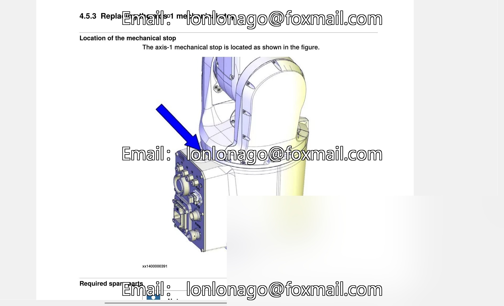
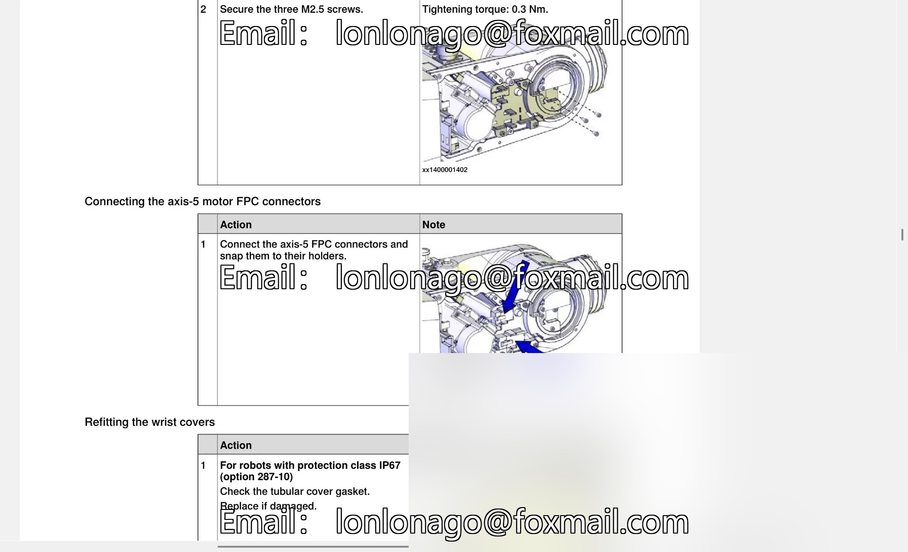
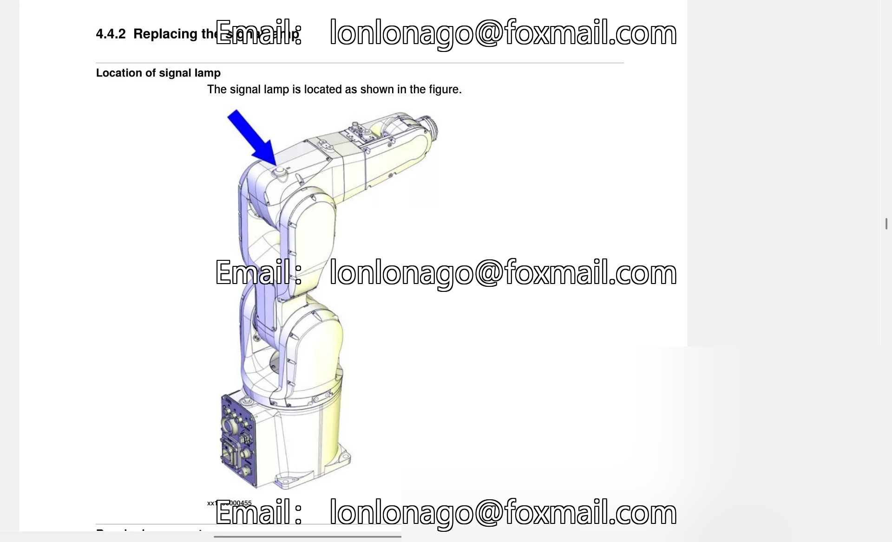

# ABB IRB 1200 series industrial robot product manual. PDF

## Body

ABB IRB 1200 series industrial robot product manual. PDF with 680 pages.
This robot is a compact and lightweight industrial robot under ABB.

IRB 1200 is a compact robot designed for applications such as small workpiece handling, assembly, picking and placement, and precision manufacturing, particularly suitable for high-speed, high-precision operations on limited-space production lines.

Main features:

Compact structure, light weight: adopting lightweight design, the footprint is small, and it is easy to integrate into existing production lines or compact workstations.

High speed and high precision: Suitable for tasks requiring rapid cycling and precisely repeated positioning, such as electronic product assembly, small part transport, and other tasks.

Flexible design: can be installed flexibly (on the ground, walls, tilt angles, etc.), adapt to various production layouts.

Excellent reliability: It inherits the stability and durability of ABB robots, suitable for continuous production environments.

342672383

The product manual covers the ABB IRB 1200 series industrial robot, PDF with 680 pages, including robot features, structural designs and operation and maintenance details.

<!-- AI_ENRICHED -->

## Images

## Payment

Here is a pay link on Stripe ( https://buy.stripe.com/3cs8yP7sY87d0vu9AB ). Please contact me lonlonago@foxmail.com after funding $89, and I will send you a complete data files , thank you!

